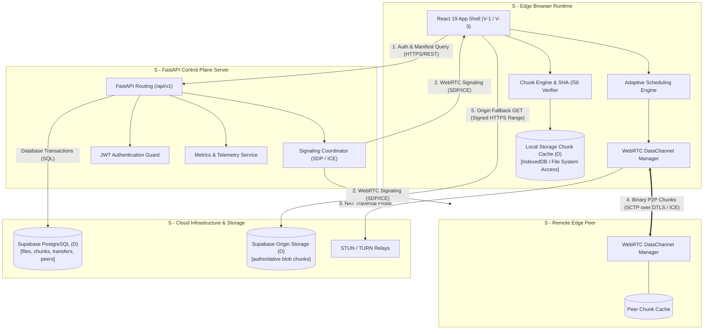

# SVD Architecture Specification

**Project:** Intelligent P2P Edge File Distribution System with Adaptive Network  
**Document Version:** 1.0.0  
**Phase:** Phase 2 — Requirements & System Design  
**Status:** Approved for Architecture Baseline  

---

## 1. Introduction to the SVD Model

The **System-View-Data (SVD)** architectural pattern decomposes the system into three complementary dimensions:
- **System (S):** The physical and logical execution infrastructure, processing nodes, communication protocols, and execution boundaries.
- **View (V):** The presentation layers, user interfaces, real-time visual telemetry, interaction states, and accessibility surfaces.
- **Data (D):** The state models, cryptographic schemas, persistent relational entities, ephemeral runtime buffers, and state transition lifecycles.

---

## 2. "S" — System Dimension

The System dimension details the actors, infrastructure services, runtime processes, and network boundaries.

```
+--------------------------------------------------------------------------------------------------+
|                                    SYSTEM TOPOLOGY BOUNDARY                                      |
+--------------------------------------------------------------------------------------------------+
|  [ ACTORS ]                                                                                      |
|  - Content Publisher (Edge Browser)                                                             |
|  - Content Downloader / Seeder (Edge Browser)                                                    |
|  - System Administrator (DevOps / Monitor)                                                       |
|                                                                                                  |
|  [ COMPUTE & EXECUTION PLATFORMS ]                                                               |
|  - S-1: Edge Browser Runtime (React 19, Web Workers, Storage / Cache, WebRTC, Web Crypto)       |
|  - S-2: Control Plane Server (FastAPI on Python 3.14, Uvicorn, Pydantic, AsyncIO)                |
|  - S-3: Relational Persistence Engine (Supabase PostgreSQL 15+, Row Level Security)              |
|  - S-4: Durable Object Storage (Supabase S3-compatible Blob Store)                               |
|  - S-5: NAT Traversal Infrastructure (RFC 5389 STUN / RFC 5766 / RFC 8656 TURN Relays)           |
+--------------------------------------------------------------------------------------------------+
```

### Component Details

#### S-1: Edge Browser Runtime Client
- **Responsibilities:**
  - Performs in-browser binary chunking (configurable, defaulting to 1 MiB) and SHA-256 digest computations using the Web Cryptography API.
  - Maintains `RTCPeerConnection` instances and WebRTC data channels (SCTP over DTLS) with swarm members.
  - Runs the client-side adaptive scheduling algorithm allocating chunk requests.
  - Manages bounded in-memory buffers, checks `navigator.storage.estimate()` where supported, stages chunks in local storage (File System Access API or IndexedDB), and handles storage quota errors.
- **Inputs:** Local user files, WebRTC data frames, HTTP range responses, signaling payloads.
- **Outputs:** P2P chunk transmissions, status telemetry, reconstructed file downloads.
- **Relationships:** Communicates with S-2 via HTTPS/REST for signaling/metadata, with peer S-1 instances via WebRTC (SCTP/DTLS), and with S-4 via HTTPS signed URLs for fallback.

#### S-2: FastAPI Control Plane Server
- **Responsibilities:**
  - Manages API routing (`/api/v1`), request validation, and JWT authorization checks.
  - Tracks active swarms and orchestrates WebRTC SDP offer/answer/ICE signaling between peers.
  - Persists and queries file manifests, chunk hash dictionaries, and session telemetry.
  - Exposes health probes, documentation (`/docs`), and aggregated network observability.
- **Inputs:** Client REST calls, signaling messages, peer registration requests, transfer metrics.
- **Outputs:** Verified manifests, peer candidate lists, forwarded signaling payloads, JSON responses.
- **Relationships:** Interfaces with S-3 via async SQLAlchemy/PostgreSQL driver and delegates object persistence to S-4.

#### S-3: Supabase PostgreSQL Database
- **Responsibilities:**
  - Authoritative persistence for user profiles, file manifests, cryptographic hashes, and transfer logs.
  - Enforces relational constraints (foreign keys, uniqueness) and Row Level Security (RLS).
- **Inputs:** Structured SQL queries, inserts, updates from S-2.
- **Outputs:** Tabular query result sets, constraint verification, transactional commit status.
- **Relationships:** Strictly accessed by S-2 using service credentials or client direct queries via Supabase client with RLS.

#### S-4: Durable Object Storage Engine
- **Responsibilities:**
  - Stores initial uploaded file assets or raw chunk archives to guarantee 100% availability.
  - Fulfills HTTP `Range: bytes={start}-{end}` queries for origin fallback requests.
- **Inputs:** Binary multipart uploads from S-1 / S-2.
- **Outputs:** Binary byte streams served over signed HTTPS URLs.
- **Relationships:** Serves fallback requests to S-1 when peer swarms are unavailable.

#### S-5: NAT Traversal Infrastructure (STUN / TURN)
- **Responsibilities:**
  - STUN assists browser clients in discovering their public IP and NAT mapping type for direct peer-to-peer connectivity.
  - TURN acts as a data relay when direct peer-to-peer UDP hole-punching fails (e.g., between symmetric NATs or restrictive firewalls). Direct connectivity cannot be guaranteed for every pair of edge nodes, and TURN introduces operational relay bandwidth, latency, and cost considerations. Provider selection (self-hosted vs. managed) remains an open decision pending Phase 4 feasibility and budget review.
- **Inputs:** Binding requests and relay allocation packets from S-1.
- **Outputs:** Public reflexive ICE candidates and relayed communication channels.
- **Relationships:** Facilitates connection establishment between separate S-1 edge nodes.

---

## 3. "V" — View Dimension

The View dimension defines the presentation states, visual telemetry, and UI components rendered in the browser.

| View Component | Target Phase | Visual Elements & States | User & System Interactions |
| :--- | :--- | :--- | :--- |
| **V-1: Project Readiness Shell** | Phase 1 (Live) | - System title and phase banner.<br>- Connection status badge (`Connected`, `Disconnected`, `Checking...`).<br>- Backend URL and health-check diagnostics. | User can click "Recheck Health Endpoint" to trigger manual poll. |
| **V-2: File Publication View** | Phase 4 | - Drag-and-drop file upload zone.<br>- Chunking progress bar (0–100%).<br>- Chunk manifest calculation indicator.<br>- Publication confirmation modal with shareable File ID / URL. | User selects file; client validates file size limits, computes SHA-256 hashes, registers manifest, and uploads to origin. |
| **V-3: Transfer Monitor View** | Phase 5 | - Overall transfer progress bar (bytes and percentage).<br>- Download speed (MB/s) and estimated time remaining (ETA).<br>- Visual Chunk Grid: interactive heatmap showing verified (green), in-flight (blue), missing (gray), and failed (red) chunks.<br>- Pause, Resume, and Cancel action buttons. | User monitors real-time chunk assembly; clicks Cancel to abort transfer and release open WebRTC channels. |
| **V-4: Peer Swarm View** | Phase 6 | - Active connected peer count.<br>- Swarm topology list: peer IDs, connection latency (ms), effective transfer rate (KB/s), delivery success ratio.<br>- P2P vs. Origin ratio gauge (e.g., 72% P2P / 28% Origin). | Visualizes real-time distribution efficiency and swarm health. |
| **V-5: Telemetry & Analytics View** | Phase 7 | - Real-time throughput time-series graphs.<br>- Aggregated swarm bandwidth savings calculator.<br>- Network route distribution (Direct P2P vs. TURN vs. Origin). | Allows user or administrator to inspect network performance and verify offload ratios. |
| **V-6: Error Boundaries & Alerts** | Phase 5 | - Contextual alert banners for WebRTC disconnection, STUN timeouts, chunk hash mismatches, or origin fallback activation.<br>- Retry action prompts. | Renders non-intrusive recovery alerts without crashing the application shell. |

---

## 4. "D" — Data Dimension

The Data dimension defines the core entities, relationships, attributes, and data lifecycles across the system.

### Entity Relationship Model

```
+--------------------+        1:N        +--------------------+        1:N        +--------------------+
|      profiles      | ----------------- |       files        | ----------------- |    file_chunks     |
| - id (UUID, PK)    |                   | - id (UUID, PK)    |                   | - id (UUID, PK)    |
| - email            |                   | - owner_id (FK)    |                   | - file_id (FK)     |
| - created_at       |                   | - name, size       |                   | - chunk_index      |
+--------------------+                   | - sha256_hash      |                   | - sha256_hash      |
          |                              | - chunk_size       |                   | - byte_offset      |
          |                              +--------------------+                   | - byte_length      |
          | 1:N                                    |                              +--------------------+
          |                                        | 1:N                                    |
          v                                        v                                        |
+--------------------+                   +--------------------+                             |
|   peer_sessions    |                   |     transfers      |                             |
| - id (UUID, PK)    |                   | - id (UUID, PK)    |                             |
| - user_id (FK)     |                   | - file_id (FK)     |                             |
| - peer_id (string) |                   | - user_id (FK)     |                             |
| - is_active        |                   | - status           |                             |
| - last_seen_at     |                   | - bytes_transferred|                             |
+--------------------+                   +--------------------+                             |
                                                   |                                        |
                                                   | 1:N                                    |
                                                   v                                        v
                                         +-------------------------------------------------------+
                                         |                    transfer_chunks                    |
                                         | - id (UUID, PK)                                       |
                                         | - transfer_id (FK)                                    |
                                         | - chunk_id (FK)                                       |
                                         | - source_type ('p2p' | 'origin')                      |
                                         | - source_peer_id (string, nullable)                   |
                                         | - verification_status ('pending'|'verified'|'failed') |
                                         | - latency_ms, transfer_time_ms                        |
                                         +-------------------------------------------------------+
```

### Data Lifecycles

1. **Persistent Metadata (PostgreSQL):**
   - Stored permanently (or until user deletion).
   - Authoritative for file identity, byte sizes, and cryptographic SHA-256 integrity digests.
2. **Transient Control Plane State (FastAPI In-Memory / Redis):**
   - Ephemeral signaling tickets, SDP offers/answers, and trickle ICE candidates.
   - Discarded immediately upon connection establishment or expiration ($\le 60$ seconds).
3. **Transient Edge Data (Browser Memory & Local Storage Cache):**
   - Individual 64 KB message frames buffered during multi-packet chunk assembly in bounded memory.
   - Verified chunks cached in temporary storage (File System Access API or IndexedDB) during active transfer, subject to dynamic browser storage quotas.
   - Managed with explicit `QuotaExceededError` detection, user cancellation handling, and systematic cleanup of temporary chunks upon transfer conclusion.
4. **Authoritative Blob Data (Origin Object Storage):**
   - Stored in private S3 buckets. Accessed exclusively via time-limited pre-signed URLs generated by the control plane.

---

## 5. End-to-End SVD Architecture Diagram


