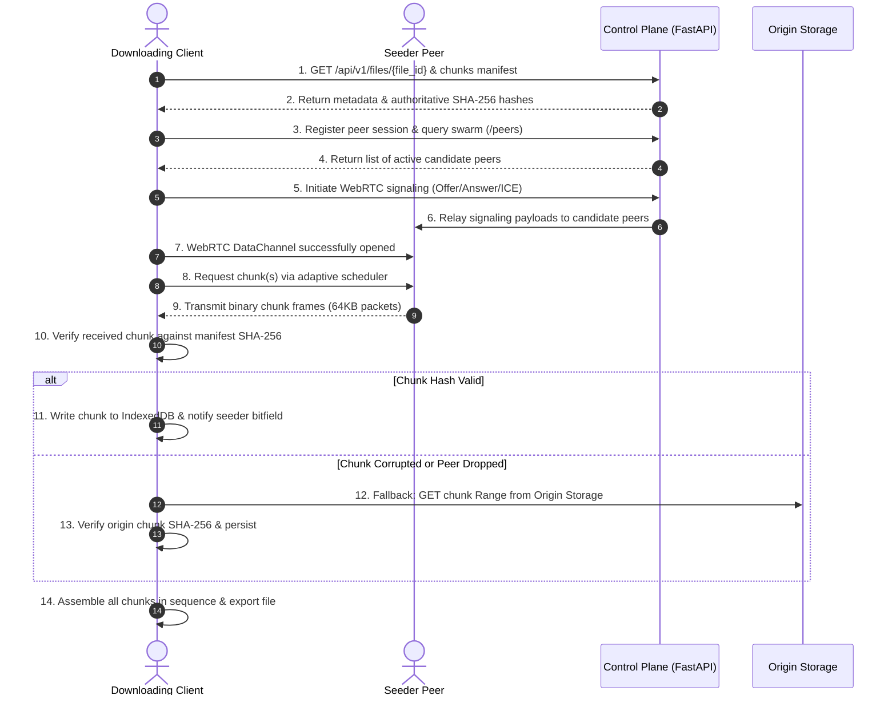

# System Architecture Document

**Project:** Intelligent P2P Edge File Distribution System with Adaptive Network  
**Document Version:** 1.0.0  
**Phase:** Phase 2 — Requirements & System Design  
**Status:** Approved for Architecture Baseline  

---

## 1. Architecture Overview

The Intelligent P2P Edge File Distribution System uses a **hybrid decoupled architecture** engineered to maximize edge distribution efficiency while ensuring 100% download reliability. The system strictly separates the **Control Plane** (orchestration, authentication, metadata, signaling, peer coordination, and telemetry aggregation) from the **Data Plane** (high-throughput binary chunk distribution directly between browser edge nodes via WebRTC DataChannels, with an origin object storage fallback).

```
                      +---------------------------------------+
                      |         Control Plane (HTTPS)         |
                      |  - FastAPI API Server                 |
                      |  - Supabase PostgreSQL (Metadata)     |
                      |  - Supabase Auth (JWT Validation)     |
                      |  - WebRTC Signaling Coordinator       |
                      +-------------------+-------------------+
                                          |
                        Signaling / REST  |  Signaling / REST
                         Metadata Queries |  Metadata Queries
                                          |
               +--------------------------+--------------------------+
               |                                                     |
               v                                                     v
+-------------------------------+                     +-------------------------------+
|     Browser Peer A (Edge)     | WebRTC (SCTP/DTLS)   |     Browser Peer B (Edge)     |
| - React 19 Client UI          | <=================> | - React 19 Client UI          |
| - Chunk Assembler             |   Direct DataPlane  | - Chunk Assembler             |
| - SHA-256 Verifier            |                     | - SHA-256 Verifier            |
| - Adaptive Scheduler          |                     | - Adaptive Scheduler          |
| - Storage & Chunk Cache       |                     | - Storage & Chunk Cache       |
+---------------+---------------+                     +---------------+---------------+
                |                                                     |
                | Fallback Chunk Streaming (HTTPS)                    | Fallback Chunk Streaming (HTTPS)
                |                                                     |
                +--------------------------+--------------------------+
                                           |
                                           v
                      +---------------------------------------+
                      |       Origin Storage Data Plane       |
                      |  - Supabase Storage (S3-compatible)   |
                      |  - Seed / Full-File Backup            |
                      +---------------------------------------+
```

---

## 2. Component Responsibilities

| Component Tier | Physical Entity | Primary Responsibilities | Protocols / Interfaces |
| :--- | :--- | :--- | :--- |
| **Client Frontend** | Browser Web Application (React 19, TypeScript, Vite) | - Presentation of publication, transfer, and telemetry UI.<br>- Cryptographic file chunking and SHA-256 hash generation.<br>- WebRTC `RTCPeerConnection` and `RTCDataChannel` lifecycle management.<br>- Adaptive chunk scheduling engine and multi-peer dispatch.<br>- SHA-256 chunk integrity verification and streaming assembly.<br>- Storage quota estimation and origin fallback orchestration. | WebRTC DataChannel (SCTP/DTLS), HTTPS/REST, WebSockets, Web Cryptography API, File System Access API / IndexedDB |
| **Control Plane API** | FastAPI Application (Python 3.14 / Uvicorn) | - Authentication and authorization enforcement.<br>- File and chunk metadata registration and queries.<br>- Active peer session tracking and swarm discovery.<br>- WebRTC SDP Offer/Answer and ICE candidate exchange broker.<br>- Transfer lifecycle recording and metrics telemetry aggregation. | HTTPS/REST, JSON schemas, Pydantic Settings |
| **Relay & Traversal** | STUN / TURN Servers (RFC 5389 / 5766 / 8656) | - STUN: Assisting public IP/port discovery for reflexive ICE candidate generation.<br>- TURN: Relaying data packets when direct peer connectivity cannot be established due to symmetric NAT or firewall policies (with associated relay bandwidth, latency, and cost considerations). | STUN (UDP/TCP 3478), TURN (UDP/TCP 3478, TLS 5349) |
| **Relational Database**| Supabase PostgreSQL | - Persistent storage of user profiles, file records, chunk manifests, active peer sessions, transfer events, and audit logs.<br>- Enforcement of database-level integrity and Row Level Security (RLS). | PostgreSQL wire protocol, SQL |
| **Origin Storage** | Supabase Storage (S3-Compatible Object Store) | - Authoritative durable repository for published files.<br>- Serves byte-range HTTP requests for individual missing chunks during origin fallback.<br>- Provides guaranteed availability when zero peers are connected. | HTTPS REST API (S3 API / Signed URLs) |

---

## 3. Control-Plane and Data-Plane Separation

A foundational architectural rule of this system is that **no binary file payload ever passes through the FastAPI control plane**:

1. **Control Plane Traffic:**
   - Carries strictly lightweight metadata: file names, byte lengths, SHA-256 hexadecimal digests, peer identifiers, connection status flags, SDP descriptions, ICE candidate structures, and transfer performance metrics.
   - Keeps backend memory and CPU overhead minimal, allowing the control plane to scale horizontally to thousands of concurrent swarms without becoming an I/O bottleneck.
2. **Data Plane Traffic:**
   - Operates over two distinct pathways:
     - **Primary Path (P2P):** Direct peer-to-peer WebRTC `RTCDataChannel` transports raw binary chunk frames between browsers.
     - **Secondary Path (Origin Fallback):** Direct HTTPS Range requests from the client browser to Supabase Storage signed URLs.
   - Decoupled from the control plane's compute capacity.

---

## 4. Trust Boundaries

```
[ UNTRUSTED ZONE ]               [ SECURE CONTROL PLANE ]            [ CLOUD INFRASTRUCTURE ]
+----------------------+         +----------------------+            +-----------------------+
|  Browser Peer (Self) |         |                      |            |                       |
+----------------------+         |  FastAPI Backend     |            |  Supabase PostgreSQL  |
           ^                     |  - JWT Verification  | <=======>  |  (RLS Protected)      |
           | WebRTC DataChannel  |  - Schema Validation |   SQL      |                       |
           v (Zero Trust)        |                      |            +-----------------------+
+----------------------+         +----------------------+            +-----------------------+
|  Remote Edge Peer    |                    ^                        |                       |
|  (Potential Bad Actor)|                   | HTTPS (TLS 1.3)        |  Supabase Storage     |
+----------------------+                    v                        |  (Signed S3 URLs)     |
                            +-------------------------------+ <====> |                       |
                            |  Browser Client Session       |  HTTPS +-----------------------+
                            +-------------------------------+
```

### Trust Boundary Rules
1. **Remote Peers Are Untrusted:**
   A peer in the swarm can be malicious, compromised, or malfunctioning. Data received from a peer data channel is treated as untrusted binary input. It is quarantined in memory until its SHA-256 checksum matches the signed manifest hash received from the authenticated control plane.
2. **Control Plane Is Authoritative for Metadata:**
   The client trusts metadata (file size, chunk count, chunk hashes) received over authenticated HTTPS from the FastAPI backend.
3. **Database Is Protected by Row Level Security (RLS):**
   Client access to PostgreSQL entities is mediated by Supabase Auth JWT tokens and RLS policies, preventing unauthorized users from modifying swarm states or accessing private file records.
4. **Origin Storage Is Authenticated via Signed URLs:**
   Direct browser downloads from origin storage use time-limited signed URLs generated by the control plane upon authorization verification.

---

## 5. End-to-End Data Flows

### 5.1 File Publication Flow
```mermaid
sequenceDiagram
    autonumber
    actor Publisher as Publishing Client
    participant CP as Control Plane (FastAPI)
    participant DB as PostgreSQL
    participant Store as Origin Object Storage

    Publisher->>Publisher: 1. Split local file into 1MB chunks
    Publisher->>Publisher: 2. Compute SHA-256 for each chunk & full file
    Publisher->>CP: 3. POST /api/v1/files (metadata & total hash)
    CP->>DB: 4. Insert file record (status: pending)
    CP-->>Publisher: 5. Return file_id & chunk upload ticket
    Publisher->>CP: 6. POST /api/v1/files/{file_id}/chunks (manifest)
    CP->>DB: 7. Batch insert chunk manifest records
    Publisher->>Store: 8. Upload file/chunks to Origin Object Storage
    Publisher->>CP: 9. PATCH /api/v1/files/{file_id} (status: active)
    CP->>DB: 10. Update file status to 'active'
    Publisher->>CP: 11. Register self as initial active seeder peer
    CP-->>Publisher: 12. Publication complete; swarm initialized
```

### 5.2 File Download Flow


---

## 6. Signaling and Peer-Connection Lifecycle

The signaling channel manages the asynchronous negotiation required for two browsers to discover each other, traverse NATs, and establish a direct `RTCPeerConnection`:

```mermaid
stateDiagram-v2
    [*] --> Idle: Browser loads client
    Idle --> Registering: User enters file swarm
    Registering --> SwarmConnected: Peer ID assigned & registered
    SwarmConnected --> SignalingOffer: Select peer candidate & generate SDP Offer
    SignalingOffer --> SignalingAnswer: Control plane relays offer; remote returns SDP Answer
    SignalingAnswer --> IceExchange: Exchange trickle ICE candidates via signaling
    IceExchange --> Connecting: ICE agent tests candidate pairs
    Connecting --> DataChannelOpen: Direct WebRTC DataChannel established
    Connecting --> Failed: ICE timeout (NAT traversal failure)
    Failed --> OriginFallback: Revert to direct Origin Storage download
    DataChannelOpen --> ActiveTransfer: Streaming chunk requests & responses
    ActiveTransfer --> HeartbeatCheck: Ping/Pong liveness monitor
    HeartbeatCheck --> DataChannelOpen: Alive
    HeartbeatCheck --> PeerDisconnected: Heartbeat missing > 5s
    PeerDisconnected --> RescheduleChunks: Reschedule unverified chunks
    ActiveTransfer --> SwarmClosed: Transfer complete or tab closed
    SwarmClosed --> [*]
```



---

---

## 7. Chunk Integrity, Storage Quotas, and Reconstruction

1. **Configurable Chunk Sizing:**
   Chunks are sized at a configurable boundary, with **1 MiB (1,048,576 bytes)** established as the current architectural design default rather than a universal optimum. Terminal chunks have length $L \le \text{chunk\_size}$.
2. **Chunk Fragmentation Over DataChannel:**
   Because browser `RTCDataChannel` implementations degrade or throw buffer overflow exceptions when sending large single messages, each 1 MiB chunk is fragmented by the sender into 16 framed application packets of **64 KB**. Each packet contains:
   - `chunk_index` (4 bytes, unsigned 32-bit int)
   - `packet_offset` (4 bytes, unsigned 32-bit int)
   - `is_last_packet` (1 byte, boolean flag)
   - `payload` (binary byte array, $\le 65,536$ bytes)
3. **Reassembly & Cryptographic Hashing:**
   The receiver collects packets for a chunk into an in-memory `Uint8Array` buffer. Once all packets for that chunk index arrive, the client executes:
   $$\text{digest} = \text{crypto.subtle.digest}('SHA-256', \text{chunkData})$$
   The computed digest is compared against the chunk's manifest hash:
   - **Match:** Chunk is staged to local storage (or written via stream) and marked as available in the client's local bitfield.
   - **Mismatch:** Chunk is immediately purged from memory, the source peer's reliability score is penalized, and the chunk is re-queued for alternate peer request or origin fallback.
4. **Storage Quota Management & Bounded Memory Buffering:**
   - Available client storage varies dynamically across browser engines, devices, available disk space, and origin storage quota policies. No fixed file size can be guaranteed to fit on every client device.
   - The client avoids holding complete multi-gigabyte files in heap memory, using bounded in-memory buffers (retaining only active in-flight chunk frames).
   - Where supported, `navigator.storage.estimate()` is queried prior to transfer as an advisory guideline (not a binding guarantee).
   - If available, the File System Access API (`showSaveFilePicker()` / `createWritable()`) streams verified chunks directly to user-selected storage, with fallback to IndexedDB or direct origin streaming on unsupported browsers.
   - The storage layer explicitly catches and handles `QuotaExceededError` and write failures, presenting a descriptive user-visible error. On user cancellation, unrecoverable failure, or successful assembly, temporary chunk buffers are systematically purged.
5. **Final File Verification:**
   Once all chunks $0 \dots (N-1)$ are verified and assembled in sequence, the client asserts that the full-file SHA-256 matches `files.sha256_hash` before finalizing the file for user access.

---

## 8. Origin Fallback Strategy & Network Traversal

The origin fallback mechanism ensures that no transfer stalls due to network or peer irregularities:

### Network Traversal Realities & TURN Relay
Direct peer-to-peer connectivity cannot be guaranteed for every pair of edge nodes. Direct connection establishment depends dynamically on NAT mapping behavior (e.g., symmetric NATs), corporate or ISP firewall packet inspection, network topology, and transient network conditions. 
- **STUN** assists in discovering public reflexive endpoints for direct UDP binding.
- **TURN** provides media/data packet relaying when direct peer-to-peer traversal fails. However, TURN introduces operational relay bandwidth costs, increased latency, and server maintenance overhead. The specific TURN provider architecture (e.g., self-hosted `coturn` vs. managed cloud TURN) remains an open engineering item subject to Phase 4 feasibility testing and budget review.
- When direct P2P connectivity cannot be established and TURN is unavailable or cost-prohibitive, the system transitions deterministically to origin storage fallback.

### Trigger Conditions for Origin Fallback
1. **Zero Peers Available:** No other peers in the swarm hold the needed chunk.
2. **Signaling / NAT Failure:** Direct WebRTC connectivity could not be established with candidate peers and TURN is unavailable.
3. **Transfer Stalling / Timeout:** A requested chunk does not complete from a peer within the configurable timeout threshold:
   $$T_{\text{timeout}} = \max(2000\text{ ms}, 3 \times \text{RTT}_{\text{measured}})$$
4. **Data Corruption:** A peer delivers a chunk whose SHA-256 hash fails verification.
5. **Download Speed Inversion:** Measured aggregate P2P throughput is significantly lower than available direct origin throughput during urgent user transfers.

### Fallback Execution
The client initiates an authenticated HTTP `GET` request with a `Range: bytes={start}-{end}` header to the Supabase Storage endpoint. Upon receipt, the origin-supplied chunk undergoes identical SHA-256 verification before being committed to the file buffer.

---

## 9. Observability and Metrics

Observability telemetry is tracked on two tiers:
1. **Client-Side Live Runtime Metrics:**
   - Instantaneous and moving-average download/upload speeds (bytes/sec).
   - Peer swarm distribution: connected peers, active seeders, idle peers.
   - Chunk acquisition split: percentage of bytes acquired via P2P vs. Origin Storage.
   - Verification status grid: real-time visual bitfield map of verified chunks.
2. **Control-Plane Aggregated Telemetry & Networking Benchmarks:**
   - Swarm density and churn rate.
   - Aggregate origin bandwidth saved (bytes).
   - Frequency of SHA-256 verification rejections (anomaly detection for toxic peers).
   - **Network Traversal Benchmark Metrics (Phase 4+):**
     - Direct connection success rate (%)
     - TURN relay usage rate (%)
     - Connection establishment time (ms)
     - Connection failure rate (%)
     - Transfer completion rate by connection mode (Direct P2P vs. TURN Relay vs. Origin Fallback)

---

## 10. Security and Deployment Boundaries

- **Transport Security:** Strict HTTPS (TLS 1.3) across all REST endpoints; WebSockets use WSS; WebRTC data channels use SCTP over DTLS 1.2+ over ICE/UDP transport (RFC 8831 / RFC 8261). DTLS provides transport security (confidentiality, integrity, and endpoint authentication) for data channels. SRTP is reserved exclusively for media streams (audio/video) and is not utilized for data channels. Connectivity mechanisms (ICE, STUN, and TURN) discover network paths and relay packets; they do not replace transport encryption. Transport encryption protects data in transit but does not establish peer trust; independent application-layer SHA-256 chunk hash verification remains strictly mandatory.
- **Authentication:** Supabase Auth issues asymmetric JWT tokens parsed and verified by FastAPI's security dependencies.
- **CORS Constraints:** CORS middleware strictly enforces allowed local frontend origins (`http://localhost:5173`, `http://127.0.0.1:5173`) in development and explicitly configured domain origins in production.
- **Zero Secrets on Client:** No database connection strings, master service-role keys, or TURN admin credentials are ever shipped in frontend bundles. Only public anon keys are exposed through `VITE_` variables.
- **Deployment Strategy:**
  - Local/Dev: Local Vite dev server + Uvicorn FastAPI backend + Dockerized/hosted Supabase.
  - Production: Frontend compiled as static assets on an edge CDN; FastAPI containerized on a scalable container service; Supabase managed PostgreSQL and object storage.

---

## 11. WebRTC Signaling Architecture & Single-Process Boundaries (Phase 4.4)

1. **In-Memory Active Connection Registry:**
   - The Phase 4.4 signaling coordinator maintains an active in-memory connection registry tracking live WebSocket connections, session memberships, and sliding rate limits.
   - **Architectural Scope & Limitation:** The in-memory registry coordinates WebRTC signaling across all peers connected to a single FastAPI process. When scaling to multi-worker deployments (e.g. Uvicorn with `--workers N` or horizontal container replicas), an external pub/sub coordination layer (such as Redis Pub/Sub or Supabase Realtime broadcast) is required. Multi-instance signaling is not claimed without this external coordination layer.
2. **WebRTC Perfect Negotiation Pattern:**
   - Peers follow the W3C WebRTC Perfect Negotiation pattern to eliminate offer glare (simultaneous negotiation collisions).
   - Roles are determined deterministically: the peer with the lexicographically greater `peer_id` is designated as the "polite" peer.
   - If an offer collision occurs, the polite peer yields, rolls back its local offer, and accepts the incoming offer; the impolite peer ignores colliding offers.
3. **Queued Candidate Strategy:**
   - Trickle ICE candidates arriving before the `RTCPeerConnection` has established its remote description are enqueued safely in an in-memory queue.
   - Once `setRemoteDescription()` resolves, all queued candidates are drained and applied, preventing candidate rejection errors.
4. **Data Channel Control Boundary:**
   - In Phase 4.4, the WebRTC `RTCDataChannel` (`p2p-control`) is restricted strictly to ping/pong control messages to measure round-trip latency (RTT).
   - Binary file chunk transfer and bulk data distribution are strictly deferred to Phase 4.5.

