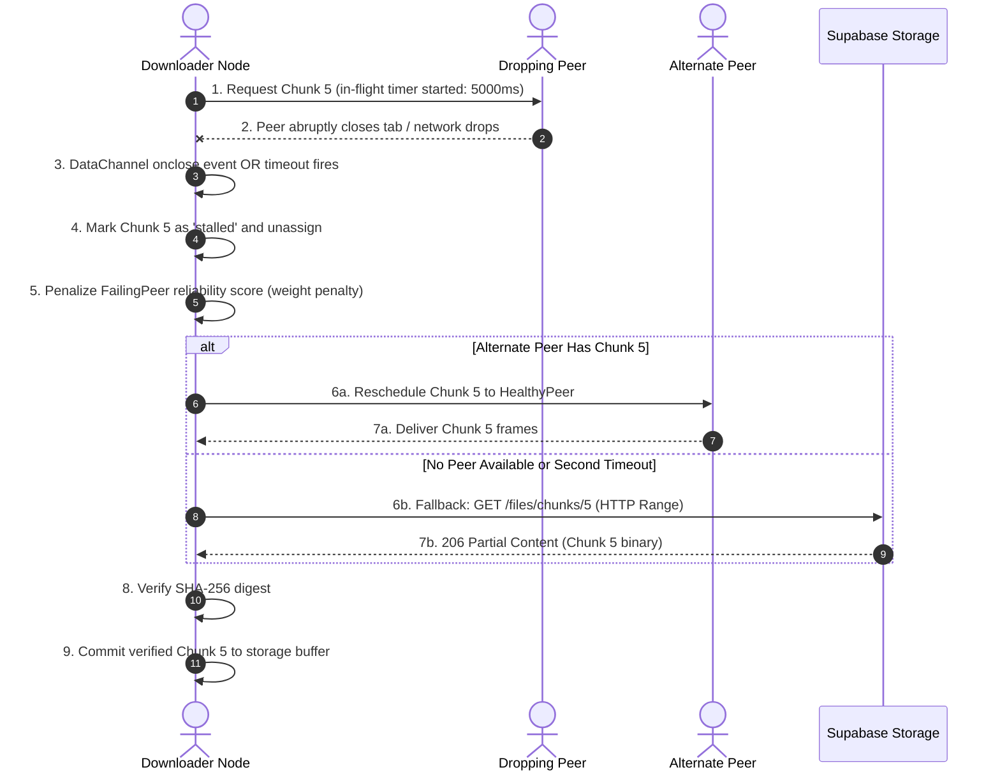
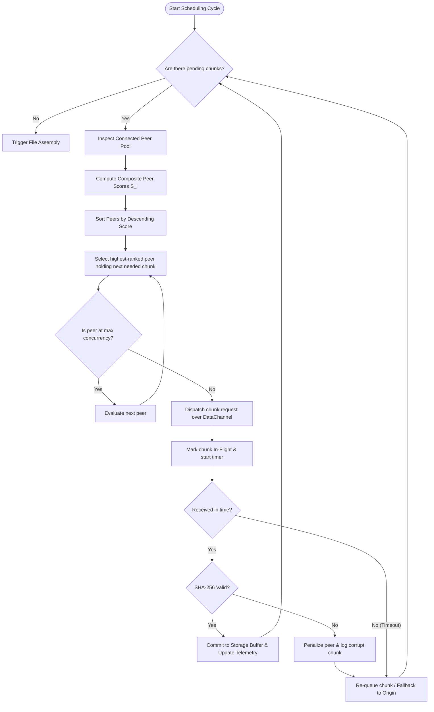
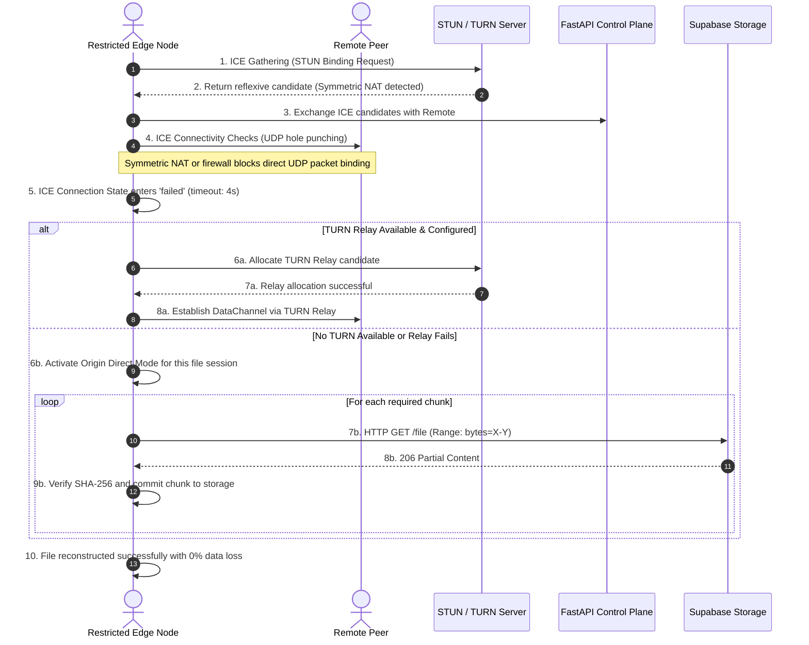
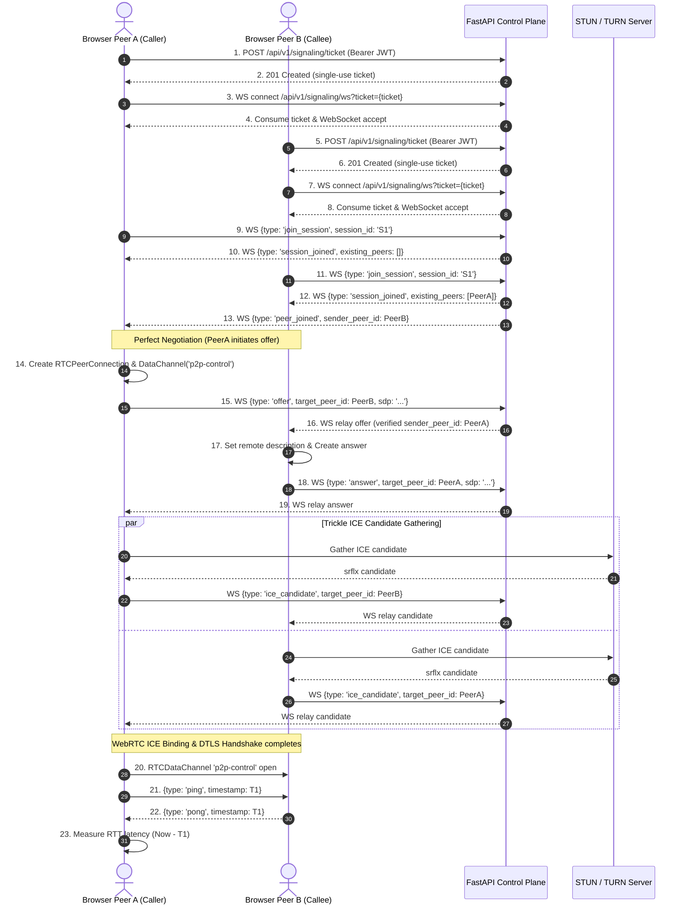

# System Workflows Specification

**Project:** Intelligent P2P Edge File Distribution System with Adaptive Network  
**Document Version:** 1.0.0  
**Phase:** Phase 2 — Requirements & System Design  
**Status:** Approved for Architecture Baseline  

---

## 1. Overview of Core Workflows

This document specifies the exact sequential execution logic for the five critical operational workflows of the system:
- **Workflow A:** File Publication & Manifest Distribution
- **Workflow B:** Multi-Source File Download & Reconstruction
- **Workflow C:** Peer Failure Detection & Rescheduling
- **Workflow D:** Adaptive Network Scheduling & Load Balancing
- **Workflow E:** Network Traversal Failure & Origin Fallback

---

## 2. Workflow A: File Publication

File publication converts a local file on a publisher's computer into a verifiable, distributed asset backed by both origin storage and peer seeding.

```mermaid
sequenceDiagram
    autonumber
    actor Publisher as Publishing Edge Node
    participant WebWorker as In-Browser Crypto Worker
    participant API as FastAPI Control Plane
    participant DB as PostgreSQL
    participant Origin as Supabase Object Storage

    Publisher->>Publisher: 1. User selects file via UI file picker
    Publisher->>Publisher: 2. Validate client constraints (size <= 5GB, mime type)
    Publisher->>WebWorker: 3. Dispatch file buffer for chunk slicing (configurable, default 1 MiB blocks)
    loop For each chunk (0 to N-1)
        WebWorker->>WebWorker: 4. Compute chunk SHA-256 digest
    end
    WebWorker->>WebWorker: 5. Compute full-file SHA-256 digest
    WebWorker-->>Publisher: 6. Return manifest with array of hashes
    Publisher->>API: 7. POST /api/v1/files (metadata, size, total hash)
    API->>DB: 8. Insert record in `files` (status: 'pending')
    API-->>Publisher: 9. Return file_id & signed storage upload URL
    Publisher->>API: 10. POST /api/v1/files/{file_id}/chunks (manifest array)
    API->>DB: 11. Batch insert into `file_chunks`
    API-->>Publisher: 12. Confirm manifest registration
    Publisher->>Origin: 13. PUT file stream to signed URL
    Origin-->>Publisher: 14. 200 OK (storage confirmed)
    Publisher->>API: 15. PATCH /api/v1/files/{file_id} (status: 'active')
    API->>DB: 16. Update file status to 'active'
    Publisher->>API: 17. POST /api/v1/peers/register (self as initial seeder)
    API-->>Publisher: 18. Publication complete; shareable URL generated
```

### Detailed Steps:
1. **Selection & Validation:** The user selects a file in the browser UI. The frontend validates that the file size is non-zero and within configured limits.
2. **Chunking & Hashing:** Slicing is offloaded to a Web Worker to keep the UI thread responsive at 60 FPS. The worker slices the file into configurable chunks (defaulting to 1 MiB / 1,048,576 bytes), computes SHA-256 digests for each chunk, and computes the master SHA-256 for the entire file.
3. **Metadata Registration:** The client calls `POST /api/v1/files` with total size, chunk count, and full hash. The server validates that the hash does not conflict with active files and returns a `file_id`.
4. **Manifest Batching:** The client submits chunk boundaries and hashes to `POST /api/v1/files/{file_id}/chunks`.
5. **Origin Backup Upload:** The client uploads the file to Supabase Object Storage via a signed URL. This ensures an authoritative origin copy is always accessible.
6. **Swarm Seeding:** The publisher registers as an active seeder with bitfield `111...111`, enabling immediate P2P distribution to neighboring peers.

---

## 3. Workflow B: File Download & Verification

File download orchestrates simultaneous chunk acquisition across multiple peer data channels and fallback streams.

```mermaid
sequenceDiagram
    autonumber
    actor Downloader as Downloading Edge Node
    actor Peer1 as Edge Peer 1 (Seeder)
    actor Peer2 as Edge Peer 2 (Seeder)
    participant API as FastAPI Control Plane
    participant Origin as Supabase Storage

    Downloader->>API: 1. GET /api/v1/files/{file_id} & manifest
    API-->>Downloader: 2. Return file metadata & chunk SHA-256 hashes
    Downloader->>API: 3. POST /api/v1/peers/register (role: 'downloader')
    API-->>Downloader: 4. Return peer session token & STUN/TURN config
    Downloader->>API: 5. GET /api/v1/files/{file_id}/peers
    API-->>Downloader: 6. Return candidate list (Peer1, Peer2)
    Downloader->>API: 7. WebRTC Signaling exchange (SDP/ICE) with Peer1 & Peer2
    API->>Peer1: 8. Relay offer / receive answer
    API->>Peer2: 8. Relay offer / receive answer
    Downloader->>Peer1: 9. WebRTC DataChannel established
    Downloader->>Peer2: 9. WebRTC DataChannel established
    
    rect rgb(20, 30, 45)
    Note over Downloader, Peer2: Adaptive Multi-Peer Chunk Retrieval Loop
    Downloader->>Peer1: 10. Request Chunk 0 (via DataChannel)
    Downloader->>Peer2: 11. Request Chunk 1 (via DataChannel)
    Peer1-->>Downloader: 12. Stream 64KB frames for Chunk 0
    Peer2-->>Downloader: 13. Stream 64KB frames for Chunk 1
    Downloader->>Downloader: 14. Verify SHA-256 for Chunk 0 & Chunk 1
    Downloader->>Downloader: 15. Store verified chunks (File System Access / IndexedDB)
    end

    Downloader->>Downloader: 16. Concatenate chunks 0..N-1 in linear order
    Downloader->>Downloader: 17. Verify full-file SHA-256 matches manifest
    Downloader->>Downloader: 18. Trigger file export (Streaming write / Blob download)
    Downloader->>API: 19. PATCH /api/v1/transfers/{id} (status: 'completed')
```



### Storage Quota Guard & Bounded Buffering:
- Before initiating multi-peer retrieval, the client checks advisory quota with `navigator.storage.estimate()` where supported (treating it as an estimate, not a guarantee).
- The client uses streaming writes or bounded in-memory buffers rather than accumulating the entire file in RAM.
- If storage write fails or throws `QuotaExceededError`, the transfer halts with a descriptive error prompt and purges temporary chunks to avoid orphaned storage leaks.

---

## 4. Workflow C: Peer Failure & Rescheduling

Edge browser nodes are inherently transient. This workflow specifies how the system detects and recovers from peer churn without user disruption.



### Protocol Invariants:
1. **In-Flight Chunk Locks:** When a chunk is assigned to a peer, it is locked with an active deadline timer:
   $$T_{\text{deadline}} = \text{now}() + \max(3000\text{ ms}, 2.5 \times \text{RTT}_p)$$
2. **Failure Classification:**
   - *Hard Disconnect:* `RTCDataChannel.onclose` or `iceConnectionState == 'disconnected'` immediately triggers chunk reassignment.
   - *Soft Stall:* DataChannel remains open, but packets cease flowing. Timer expiry reclaims the chunk lock.
3. **Blacklisting & Degradation:** A peer that fails 3 consecutive chunk deliveries or delivers 1 corrupt chunk has its score set to 0 and its connection closed.

---

## 5. Workflow D: Adaptive Scheduling Execution Loop

The adaptive scheduling loop continuously allocates chunk requests across active peers to maximize collective throughput.



---

## 6. Workflow E: Network Restrictions & Origin Fallback

When two peers cannot connect directly due to NAT mapping behaviors or corporate firewall policies, the system falls back gracefully.



---

## 7. Workflow F: WebRTC Signaling Handshake & Data Channel Setup (Phase 4.4)

The Phase 4.4 signaling workflow establishes direct SCTP/DTLS WebRTC data channels between authenticated browser nodes using FastAPI WebSocket coordination and single-use tickets.


